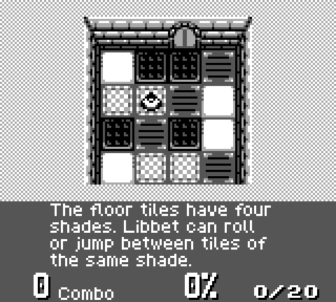

# BoyDMG

A Game Boy (DMG) emulator written in C, with a native macOS window.
It comes with a free game, so it's playable right after building.



## Quick start

You need macOS and Apple's command line tools. If you've never installed them:

```
xcode-select --install
```

Then, from this folder:

```
make run
```

That builds the emulator and starts the included game, _Libbet and the Magic Floor_.

## Controls

| Game Boy | Keyboard           |
| -------- | ------------------ |
| D-pad    | Arrow keys         |
| A        | Z                  |
| B        | X                  |
| Start    | Return             |
| Select   | Shift or Backspace |

Z and X also work on non-US keyboard layouts. To check that keys reach the
emulator, run `make run SHOW_KEYS=1`: every key press is listed in Terminal.

Cmd+Q or closing the window quits. Games with a save battery are saved
automatically every few seconds and on exit, to a `.sav` file next to the ROM.

## Playing other games

Put a `.gb` file in `roms/`, then either:

```
make run ROM="roms/Your Game.gb"
```

or run `./build/boy_dmg` with no file and choose one in the file picker.

## What's supported

- The complete CPU, including interrupts, HALT and its hardware quirk
- Graphics: background, window, and sprites (8x8 and 8x16, flipping, priority,
  the 10-per-line limit), plus the screen interrupts games use for effects
- Timer, joypad, and sprite DMA
- Cartridges: plain ROM, MBC1, MBC2, MBC3, and MBC5 (the chip GB Studio games use),
  with battery saves
- Runs at the real Game Boy speed, about 59.7 frames per second

Not included yet:

- **Sound.** Games run normally, just silently.
- **Game Boy Color.** Games that work on both systems run in grey; Color-only games won't run.
- The MBC3 real-time clock is present but doesn't tick, so games that track real time won't see it pass.

## Tests

```
make test
```

This downloads a set of well-known emulator test ROMs (the first time only) and checks:

| Test                      | What it proves                                     |
| ------------------------- | -------------------------------------------------- |
| `cpu_instrs` (Blargg)     | Every CPU instruction gives the right result       |
| `instr_timing` (Blargg)   | Every instruction takes the right number of cycles |
| `halt_bug` (Blargg)       | The HALT instruction's hardware quirk              |
| `dmg-acid2` (Matt Currie) | Graphics are pixel-exact                           |
| Cartridge checks          | Bank switching and save files for each chip type   |

The test runner works on Linux too, so the tests can run on a CI service.

## Project layout

```
include/           header files
src/cpu.c          the CPU: every instruction, interrupts, HALT
src/bus.c          memory map, timer, serial port, joypad and DMA registers
src/ppu.c          graphics: draws each line, raises screen interrupts
src/cart.c         ROM loading, cartridge chips, save files
src/joypad.c       button state
src/main.c         the main loop: runs frames at real speed
src/frontend_cocoa.m   macOS window, keyboard and file picker
tests/             headless test runner and cartridge checks
roms/              the included game, and where your games go
```

To use the classic green screen instead of grey, swap the colors at the top of `src/ppu.c`
(the green values are in the comment there).

## Credits

- _Libbet and the Magic Floor_ by Damian Yerrick, zlib License. See `roms/README.md`.
- Test ROMs by Shay Green (Blargg) and Matt Currie. They're downloaded, not included.
